<a href="https://torstenyoung.com"><picture><source media="(prefers-color-scheme: dark)" srcset="assets/banner-dark.svg"></picture></a>
  
<a href="https://torstenyoung.com"><picture><source media="(prefers-color-scheme: dark)" srcset="assets/link-website-dark.svg"></picture></a>
<a href="https://torstenyoung.com/en/projects/"><picture><source media="(prefers-color-scheme: dark)" srcset="assets/link-projects-dark.svg"></picture></a>
<a href="https://torstenyoung.com/en/blog/"><picture><source media="(prefers-color-scheme: dark)" srcset="assets/link-blog-dark.svg"></picture></a>
<a href="https://photos.torstenyoung.com"><picture><source media="(prefers-color-scheme: dark)" srcset="assets/link-photos-dark.svg"></picture></a>
<a href="https://www.linkedin.com/in/torsten-young/"><picture><source media="(prefers-color-scheme: dark)" srcset="assets/link-linkedin-dark.svg"></picture></a>
  
<picture><source media="(prefers-color-scheme: dark)" srcset="assets/intro-dark.svg"></picture>
  
<a href="https://github.com/WhyFenceCode/personal-site"><picture><source media="(prefers-color-scheme: dark)" srcset="assets/personal-site-dark.svg"></picture></a>
<a href="https://github.com/WhyFenceCode/photo-site"><picture><source media="(prefers-color-scheme: dark)" srcset="assets/photo-site-dark.svg"></picture></a>
<a href="https://github.com/WhyFenceCode/extracurricular-api"><picture><source media="(prefers-color-scheme: dark)" srcset="assets/extracurricular-api-dark.svg"></picture></a>
<a href="https://github.com/WhyFenceCode/casthub"><picture><source media="(prefers-color-scheme: dark)" srcset="assets/casthub-dark.svg"></picture></a>
<a href="https://github.com/IrisShaders/docs"><picture><source media="(prefers-color-scheme: dark)" srcset="assets/docs-dark.svg"></picture></a>
<a href="https://github.com/WhyFenceCode/ChangingGrid"><picture><source media="(prefers-color-scheme: dark)" srcset="assets/ChangingGrid-dark.svg"></picture></a>

<!-- Generated by the website (personal-site: src/lib/github-profile.ts, from github: in src/config/site.yaml).
     To update: build the site, copy dist/github/README.md here, and copy dist/github-banner-*.svg and
     dist/github/*.svg into assets/ (renaming github-banner-<theme>.svg to banner-<theme>.svg). -->
