<a href="https://torstenyoung.com">
  <picture>
    <source media="(prefers-color-scheme: dark)" srcset="assets/banner-dark.svg">
    
  </picture>
</a>

Engineering student at Queen's University in Kingston, Ontario. I do whatever I like with code.

[Website](https://torstenyoung.com) · [Projects](https://torstenyoung.com/en/projects/) · [Blog](https://torstenyoung.com/en/blog/) · [Photos](https://photos.torstenyoung.com) · [LinkedIn](https://www.linkedin.com/in/torsten-young/)

<a href="https://github.com/WhyFenceCode/personal-site"><picture>
  <source media="(prefers-color-scheme: dark)" srcset="assets/personal-site-dark.svg">
  
</picture></a>
<a href="https://github.com/WhyFenceCode/photo-site"><picture>
  <source media="(prefers-color-scheme: dark)" srcset="assets/photo-site-dark.svg">
  
</picture></a>
<a href="https://github.com/WhyFenceCode/extracurricular-api"><picture>
  <source media="(prefers-color-scheme: dark)" srcset="assets/extracurricular-api-dark.svg">
  
</picture></a>
<a href="https://github.com/WhyFenceCode/casthub"><picture>
  <source media="(prefers-color-scheme: dark)" srcset="assets/casthub-dark.svg">
  
</picture></a>

<!-- The banner and the repo cards are generated by the website (personal-site: src/pages/github-banner-[theme].svg.ts
     and src/pages/github/[card].svg.ts; the cards' repos are github.cards in src/config/site.yaml).
     To update them: build the site, then copy /github-banner-*.svg and dist/github/*.svg into assets/. -->
